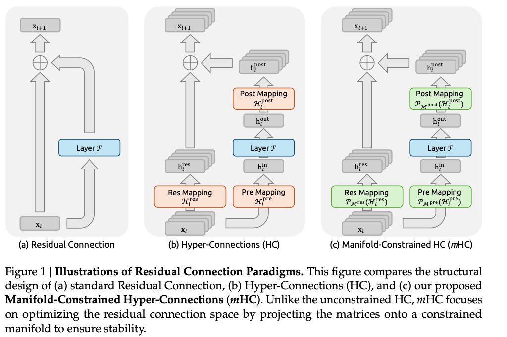
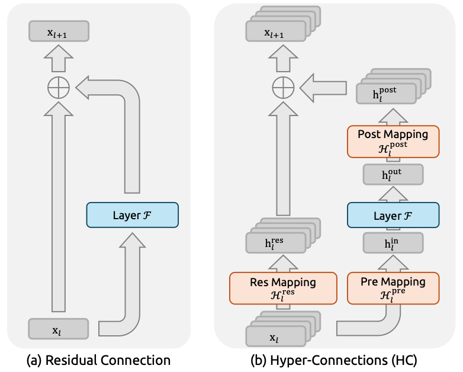
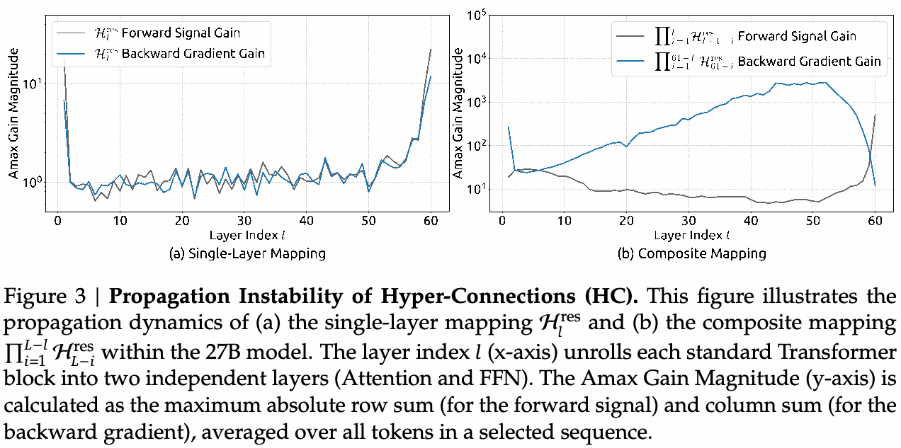
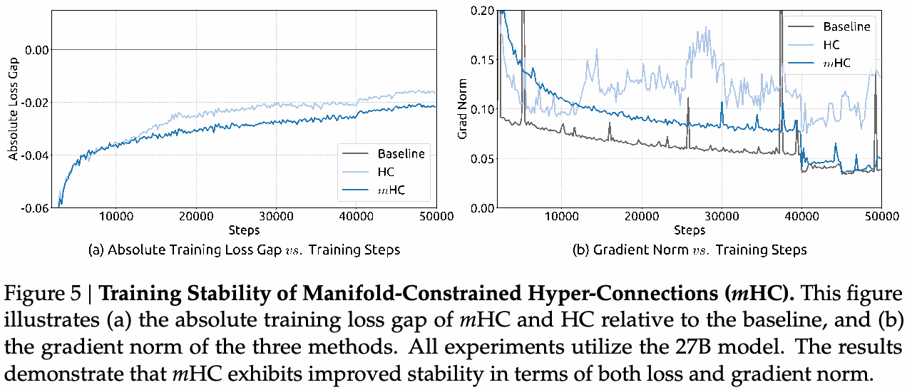
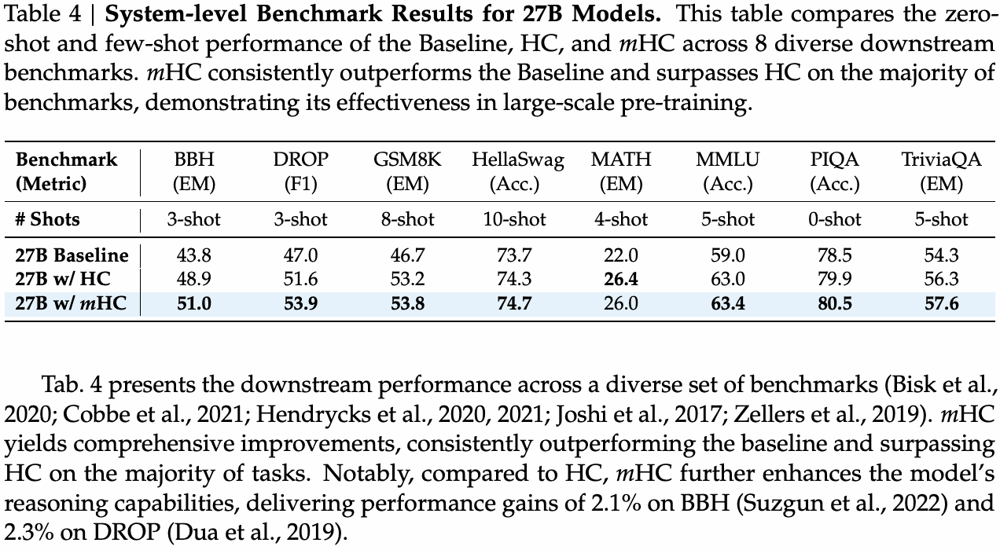

[https://arxiv.org/abs/2512.24880](https://arxiv.org/abs/2512.24880)

mHC 2025年12月31日发布，被正式引入 2026 年 4 月发布的 DeepSeek-V4 主干网络中。用于替代传统的单流残差连接，增强跨层信息融合

## 经典残差链接与恒等映射

从ResNet 到 Transformer 训练不崩溃的核心原因是因为有 残差链接

$$
x_{l+1}=x_l+F(x_l,W_l)
$$

因为有残差链接在，浅层的信号可以不经任何修改，无损的达到深层。 同理，反向传播时 梯度也能无损的传回浅层

这个保证了模型训练能够不崩溃。这是一种恒等映射。这里所谓的恒等映射其实就是 输入是啥输出就是啥。

## Hyper-Connections -HC

字节在 2024年提出 HC试图打破这种单一的残差结构

$$
x_{l+1}=\mathcal{H}_l^{\mathrm{res}}x_l+\mathcal{H}_l^{\mathrm{post}\top}F(\mathcal{H}_l^{\mathrm{pre}}x_l,W_l)
$$

对比图可以看下图

这里主要有几点变化

（1） 残差流变宽了：以前主干道上的信号 $x_l$ 维度是 $1\times C$ 现在扩宽了 $n$ 倍。这里如何拿到n份 输入的向量其实很简单，直接靠复制n份实现的。

（2） 新增了三个可学习的矩阵  pre矩阵 维度是1 × n  它的作用是 从n条输入向量中 按权重对向量进行合并，合并成一条向量 送入 函数F 。 post 矩阵负责把 F加工出来的向量 按比例分配回n条向量   res矩阵负责 对向量原始信息做线性组合。这里所谓的线性组合是指，原本输入的xl 为

$$
\mathcal{H}_l^{\mathrm{res}}=
\begin{bmatrix}
0.7 & 0.2 & 0.1 & 0.0 \\
0.1 & 0.6 & 0.1 & 0.2 \\
0.2 & 0.1 & 0.7 & 0.0 \\
0.0 & 0.1 & 0.1 & 0.8
\end{bmatrix}
$$

对于第一行，当它乘以res矩阵后，

$$
\begin{bmatrix}
0.7 & 0.2 & 0.1 & 0.0 \\
0.1 & 0.6 & 0.1 & 0.2 \\
0.2 & 0.1 & 0.7 & 0.0 \\
0.0 & 0.1 & 0.1 & 0.8
\end{bmatrix}
\times
\begin{bmatrix}
v_{1,1} & v_{1,2} & v_{1,3} \\
v_{2,1} & v_{2,2} & v_{2,3} \\
v_{3,1} & v_{3,2} & v_{3,3} \\
v_{4,1} & v_{4,2} & v_{4,3}
\end{bmatrix}
$$

结果第一行的第 1 个元素：$0.7\cdot v_{1,1}+0.2\cdot v_{2,1}+0.1\cdot v_{3,1}+0.0\cdot v_{4,1}$

结果第一行的第 2 个元素：$0.7\cdot v_{1,2}+0.2\cdot v_{2,2}+0.1\cdot v_{3,2}+0.0\cdot v_{4,2}$

结果第一行的第 3 个元素：$0.7\cdot v_{1,3}+0.2\cdot v_{2,3}+0.1\cdot v_{3,3}+0.0\cdot v_{4,3}$

所以可以视作第一行变为

$$
\mathbf{v}_1^{\mathrm{new}}=0.7\mathbf{v}_1+0.2\mathbf{v}_2+0.1\mathbf{v}_3+0.0\mathbf{v}_4
$$

新的第 1 行向量，保留了原来第 1 行的 70% 信息，同时掺入了 20% 的第 2 行信息和 10% 的第 3 行信息。

HC 试图在不增加核心算力消耗的前提下，通过将单一残差流拓宽为多条可动态路由的并行轨道，让模型在每一层都能自由调度保留历史记忆与写入新特征的比例，从而突破深层网络的表达瓶颈

### HC的痛点1-破坏恒等映射

$$
\begin{aligned}
x_L &= \left(\prod_{i=1}^{L-l}\mathcal{H}_{L-i}^{\mathrm{res}}\right)x_l \\
&\quad + \sum_{i=l}^{L-1}\left(\prod_{j=1}^{L-1-i}\mathcal{H}_{L-j}^{\mathrm{res}}\right)\mathcal{H}_i^{\mathrm{post}\top}\mathcal{F}(\mathcal{H}_i^{\mathrm{pre}}x_i,W_i),
\end{aligned}
$$

对比传统 ResNet。HC 的浅层信号 $x_l$ 要想传到深层，必须经过一长串矩阵的连乘。

在多条并行输入向量 $n$ 的架构中，理想的恒等映射必须像一个守恒装置——无论怎么混合，所有向量的平均信号强度在前后向传播中必须保持不变。 但原始 HC 对 $\mathcal{H}_l^{\mathrm{res}}$ 没有任何约束。当网络有几十上百层时，几十个无约束矩阵连乘，哪怕每层只把信号放大 1.05 倍 也会放大131.5倍。 这会导致特征的全局均值无法守恒，信号无限放大/衰减， 使得大规模训练崩溃

在文章中 下图用于展示上述结论

图 3(a) 单层看：每一层单独看 $\mathcal{H}_l^{\mathrm{res}}$，增益也就 1-10之间；

图 3(b) 跨层连乘看：把几十层连乘起来之后，这个增益直接呈指数级起飞，最高峰值冲到了3000以上。信号放大了 3000 倍

### HC的痛点2- 显存访问墙

虽然 HC 没有增加核心模块的浮点计算量但残差主干道的宽度变成了原来的 $n$ 倍。增加了搬运数据的内存访问开销

下表展示了传统残差连接和HC之前的访存计算量差异

Table 2 | **Comparison of Memory Access Costs Per Token.** This analysis accounts for the overhead introduced by the residual stream maintenance in the forward pass, excluding the internal I/O of the layer function $\mathcal{F}$.


<table>
  <thead><tr><th>Method</th><th>Operation</th><th>Read (Elements)</th><th>Write (Elements)</th></tr></thead>
  <tbody>
    <tr><td rowspan="2">Residual Connection</td><td>Residual Merge</td><td>$2C$</td><td>$C$</td></tr>
    <tr><td><strong>Total I/O</strong></td><td>$\mathbf{2C}$</td><td>$\mathbf{C}$</td></tr>
    <tr><td rowspan="6">Hyper-Connections</td><td>Calculate $\mathcal{H}_l^{\mathrm{pre}},\mathcal{H}_l^{\mathrm{post}},\mathcal{H}_l^{\mathrm{res}}$</td><td>$nC$</td><td>$n^2+2n$</td></tr>
    <tr><td>$\mathcal{H}_l^{\mathrm{pre}}$</td><td>$nC+n$</td><td>$C$</td></tr>
    <tr><td>$\mathcal{H}_l^{\mathrm{post}}$</td><td>$C+n$</td><td>$nC$</td></tr>
    <tr><td>$\mathcal{H}_l^{\mathrm{res}}$</td><td>$nC+n^2$</td><td>$nC$</td></tr>
    <tr><td>Residual Merge</td><td>$2nC$</td><td>$nC$</td></tr>
    <tr><td><strong>Total I/O</strong></td><td>$\mathbf{(5n+1)C+n^2+2n}$</td><td>$\mathbf{(3n+1)C+n^2+2n}$</td></tr>
  </tbody>
</table>


## DeepSeek的解法-mHC

面对 HC 留下的两个大坑，DeepSeek 提出了 mHC（Manifold-Constrained Hyper-Connections，流形约束超连接），核心思路也是针对这两个问题进行调整：算法上对三个矩阵加以限制，恢复全局均值守恒，通过工程调整消除访存墙。

### 用双随机矩阵重建恒等映射

无约束的 $\mathcal{H}_l^{\mathrm{res}}$ 会把信号越乘越大（$1.05^{100}\approx131.5$），针对此问题 DeepSeek 给这个 $n\times n$ 矩阵设下三个规则：

（1）所有元素必须非负：不允许出现负数把信号抵消或反转；

（2）每一行加起来必须等于 1：保证每条新向量都是旧向量的“按比例调和（凸组合）”，权重总和永远是 100%，单层绝不会放大信号；

（3）每一列加起来也必须等于 1：保证每条旧向量的信息都 100% 分配出去，不私藏也不丢弃

在数学上，同时满足“非负、行和为 1、列和为 1”的矩阵，就叫双随机矩阵（Doubly Stochastic Matrix）；而所有双随机矩阵凑在一起组成的几何空间，就叫 Birkhoff 多面体（Birkhoff Polytope）——这就是论文标题里 Manifold-Constrained（流形约束） 的由来

在文章中定义的公式为

$$
\begin{aligned}
\mathcal{P}_{\mathcal{M}^{\mathrm{res}}}(\mathcal{H}_l^{\mathrm{res}}):=\bigl\{\mathcal{H}_l^{\mathrm{res}}\in\mathbb{R}^{n\times n}\mid{} &\mathcal{H}_l^{\mathrm{res}}\mathbf{1}_n=\mathbf{1}_n, \\
&\mathbf{1}_n^\top\mathcal{H}_l^{\mathrm{res}}=\mathbf{1}_n^\top,\quad\mathcal{H}_l^{\mathrm{res}}\geq0\bigr\}
\end{aligned}
$$

双随机矩阵带来了三个绝佳性质：

(1) 总能量守恒（均值不变）：因为行和、列和都等于 1，无论 $n$ 条向量怎么交叉混合，它们合起来的全局平均值在穿过 $\mathcal{H}_l^{\mathrm{res}}$ 前后不变；

（2） 单步不爆炸：每一行都是加权平均，新向量的数值幅度被限制在合理范围内，封死了单层放大；

（3）连乘依然成立（乘法封闭性）：两个双随机矩阵相乘，结果依然是一个双随机矩阵！ 这意味着哪怕模型有 100层，100 个 $\mathcal{H}_l^{\mathrm{res}}$ 乘在一起，得到的总矩阵依然严格守恒。

（除了主干道的 $\mathcal{H}_l^{\mathrm{res}}$，mHC 也顺手给进站的 $\mathcal{H}_l^{\mathrm{pre}}$ 和出站的 $\mathcal{H}_l^{\mathrm{post}}$ 加上了非负约束，防止正负权重打架导致训练震荡）

### 梯度下降时的矩阵越界问题

双随机矩阵 $H^{\mathrm{res}}$ 当作网络里的可学习参数 $W$ 时 假设初始矩阵为

$$
W=\begin{bmatrix}0.6 & 0.4 \\ 0.4 & 0.6\end{bmatrix}
$$

在通过训练进行梯度下降后W可能变为

$$
W_{\mathrm{new}}=\begin{bmatrix}0.55 & 0.42 \\ 0.37 & 0.52\end{bmatrix}
$$

但是此时我们会发现无论从每一行的和还是从每一列的和，加起来都不再等于1

这是因为梯度下降是一个只管往 Loss 变小的方向硬推、不管几何规矩的盲目优化器。只要让它直接改矩阵里的数字，一步更新就会把行和为 1、列和为 1、非负的规则破坏掉

Sinkhorn-Knopp 算法 就是用于在梯度下降时保证矩阵仍然遵循双随机矩阵形式的算法

具体做法其实非常简单

第一步是是先有一个完全自由、没有任何限制的草稿矩阵 $\widetilde{H}$

训练时可以基于这个草稿矩阵做任意修改。

在草稿矩阵修改完后 Sinkhorn-Knopp 算法 对 草稿矩阵 所有元素 取指数 $\exp$

这会使得 把草稿矩阵里所有的数字 都变成正数（比如 $e^{-50}>0$）这就强制满足了第一条规则：所有元素非负

第二步是把每一行的数字，除以这一行的总和 此时每一行加起来都严格等于 1，但列和还不等于 1

接着把每一列的数字，除以这一列的总和。此时每一列加起来都严格等于 1（但刚才调好的行和又稍微偏离 1 了，比如变成了 1.02）Sinkhorn-Knopp 算法会重复行列归一化动作20次，让整个矩阵再次收敛到 行列和都为1

## 工程优化设计

### Kernel Fusion

Deepseek 做了 两个数学等价重构，把运算顺序调换，省掉大开销

包括 RMSNorm 和五个融合算子

### 选择性的Recomputing

在前向传播时，从第 1 层算到第 60 层，为了后面反向传播能求梯度，GPU 必须把每一层算出来的那些宽度为 $4C$ 的中间结果。如下图右边的三列 $x_l$、$\mathcal{H}_l^{\mathrm{pre}}x_l$、$\operatorname{RMSNorm}(\cdot)$

Table 3 | **Stored and Recomputed Intermediate Activations** We list per token activation preserved for the backward pass and the transient activation recomputed in $L_r$ consecutive layers. Layer $l_0$ represents the first layer in $L_r$ layers and layer $l$ is in $[l_0,l_0+L_r-1]$.


<table>
  <thead><tr><th>Activations</th><th>$x_{l_0}$</th><th>$\mathcal{F}(\mathcal{H}_l^{\mathrm{pre}}x_l,W_l)$</th><th>$x_l$</th><th>$\mathcal{H}_l^{\mathrm{pre}}x_l$</th><th>$\operatorname{RMSNorm}(\mathcal{H}_l^{\mathrm{pre}}x_l)$</th></tr></thead>
  <tbody>
    <tr><th>Size (Elements)</th><td>$nC$</td><td>$C$</td><td>$nC$</td><td>$C$</td><td>$C$</td></tr>
    <tr><th>Stored Method</th><td>Every $L_r$ layers</td><td>Every layer</td><td colspan="3">Transient inside $L_r$ layers</td></tr>
  </tbody>
</table>


60 层全存下来 = 显存里要常驻 60 份 庞大的中间数据

DeepSeek 发现，mHc的这些算子计算量小，但是结果占据显存比较多。因此选择在进行前向传播时，只计算，不存储了。具体做法是把 60 层切分成若干个小Block。假设每 $L_r=6$ 层算作一段（一共 $60/6=10$ 段）

前向传播时走过第 1、7、13、19……层（每段的第 1 层，论文叫 $x_{l_0}$）时，存进显存一共只存 10 份

中间的第 2、3、4、5、6 层产生的 mHC 宽残差中间结果，用完立刻释放显存

叫选择性重计算是因为最耗算力的 Attention 和 FFN 输出 $F(\cdot)$ 依然存着，只扔掉轻量的 mHC 中间结果

反向传播时比如现在要算第 6 层 到第 1 层的梯度，发现中间第 2～6 层的 mHC 数据全被扔了

因为手里有第 1 层的起点快照 $x_1$，可以把第 1～6 层的轻量 mHC 算子快速重算一遍，把这 6 层的中间数据临时恢复出来。算完后清空数据 即可

### 对其stage边界

多机多卡并行训练时，训练 27B 或 DeepSeek-V4 这种大模型时，单张显卡装不下 60 层，必须把这 60 层切分到多台机器上。每一台机器负责的那连续几层，就叫做一个 Pipeline Stage

假设我们有 10 台机器，那么每台机器（每个 Stage）正好分到 $60/10=6$ 层

DeepSeek决定用stage的层数 作为切分前向传播时的段数就叫 对其stage边界

这会带来两个工程红利

（1）零跨卡依赖：每个 Stage（每台机器）的第一层输入 $x_{l_0}$，本来就是上一台机器在流水线前向传播时发过来的交接班数据，天然就已经缓存在本地显卡的显存里了。

（2）反向传播开局即满速：在流水线并行里，通常每台机器反向传播时，都要干等下一台机器把梯度传回来才能开工（产生气泡等待）。现在因为本地就存着本 Stage 第 1 层的快照 $x_{l_0}$，在等梯度传过来的这段空闲时间里，显卡可以提前、独立地把本 Stage 内部 6 层的 mHC 重算先干完——等梯度一到，立刻无缝开算

## 效果

