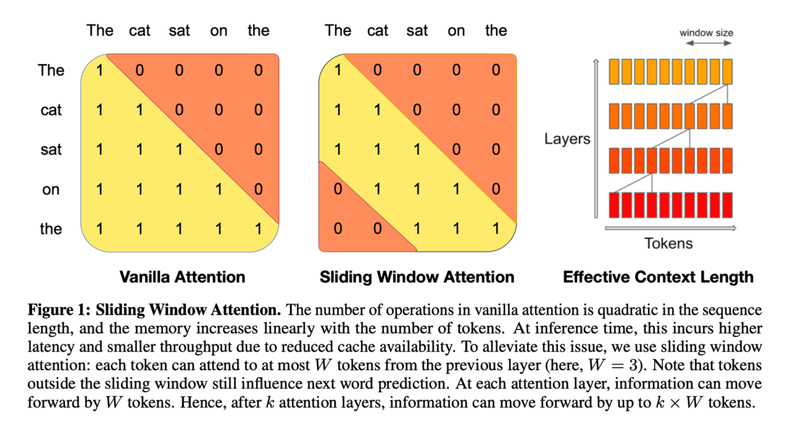
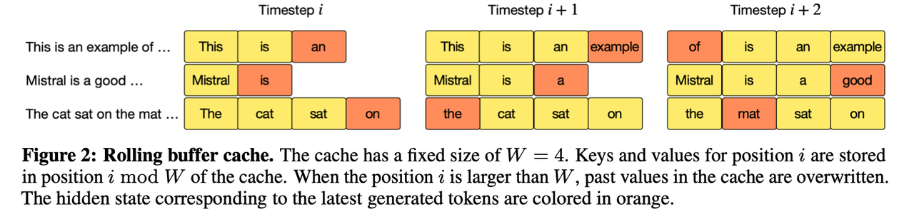
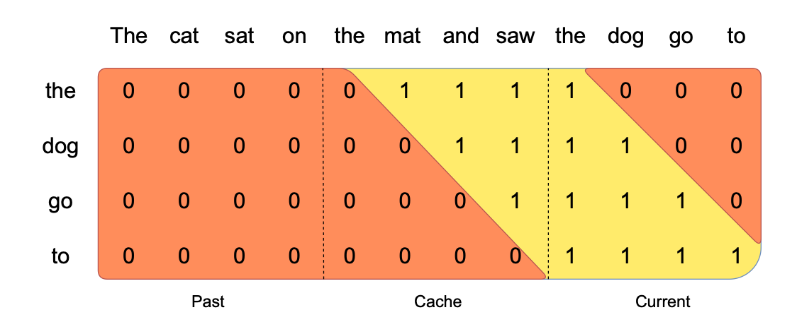
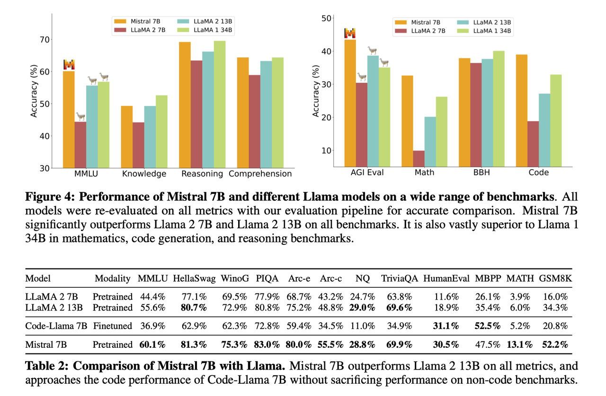

SWA诞生于 [https://arxiv.org/pdf/2004.05150](https://arxiv.org/pdf/2004.05150)  但是通过Mistral 工程上发扬出来[https://arxiv.org/pdf/2310.06825](https://arxiv.org/pdf/2310.06825)

在 Mistral 7B 之前，普遍认为在LLM 上用 SWA 会损失精度（比如 Longformer 主要用于理解类任务，且通常还需要配合全局注意力 token）

Mistral 7B 是第一个在LLM上大规模验证纯粹 SWA 可行性的，并且结合工程优化（如 Rolling Buffer Cache 滚动缓存和 FlashAttention 算子修改），把 SWA 的显存和速度优势发挥到了极致

## SWA基本原理

这张图是文章的一个架构图，

第一个图是传统的注意力可见开关，因为使用 因果掩码，呈现上三角的注意力

第二个图是 SWA(Sliding Window Attention), 其规定了一个固定的窗口W, 这个窗口就是注意力的范围。 每个token的可见范围是向看包含其自身的长度为W的 滑动窗口。

第三个图是在把模型多层都应用SWA后的有效上下文 。 图中每个竖着的小长方形 代表 某一个Token在某一层的隐藏特征。 图例花了10个小长方形代表模型推理了10个token。 从下往上画了四排。代表模型有四层。 最底下深红色的输入层（第一层）， 最上面的浅红色是第四层。其中层与层之间画了两条黑线， 这代表的当信息从下一层往上一层传递时，上层token的视野边界。

例如顶层最右面第10个token，受限于 滑窗的大小，只能读取到第三层里的7,8,9,10 四个token

## Rolling Buffer Cache

Rolling Buffer Cache 是SWA 在工程落地上的技术实现 .

在传统的大模型推理中，为了避免每次生成一个新词都要把前面所有的词重新算一遍，大家都会用 KV Cache（把历史每个词算出来的 Key 和 Value 向量存进显卡显存里。但KV Cache 句子越长，产出缓存占用的显存越长

而使用SWA, 每一层只看最近的W个词， 那么W词之前的KV 向量 理论上就不需要存在

Rolling Buffer Cache 就是把KV Cache 变成一个固定大小（滑窗大小W）的循环数组

具体的覆写机制 是 缓存位置索引 = $i \bmod W$

假设缓存一共有W个槽位， 第i个生成的token 它的kv 就直接存在 第i mode W号槽位上

一旦生成的词超过窗口，新词就会绕回到开头的槽位进行覆写

如下图所示

通过这样的方式，在处理一段32k 长度的文本时，传统模型需要存32768个词的kv cache, Mistral 7B 凭借 Rolling Buffer Cache 缓存只需要4096 减少八倍

## Pre-fill and Chunking

预填充与分块是 Mistral 7B 解决超长输入瞬时显存爆炸的配套工程方案

当用户输入给模型一份超长的prompt

在生成第一个回答词之前，用户输入的整个 Prompt 是已知的。模型不需要一个词一个词算，而是可以并行地把整个 Prompt 一次性算完，并把它们的 Key 和 Value 填进 KV Cache 里，这个阶段就叫 Pre-fill

对于 Chunk

假设 Prompt 有 32,000 个词，如果一次性全部塞进显卡做并行注意力计算，即使有 SWA，瞬间的中间激活值和计算矩阵也会非常庞大，极易导致显存溢出。 而滑动窗口大小是 $W$，作者把超长 Prompt 按照窗口大小 $W$ 切成一段段的小块。一次只算一块 $W$ 个词，算完把这一块的 KV 塞进 Rolling Buffer Cache，然后再算下一块。这样把计算时的显存峰值限制住

## 效果

## 推理时的SWA 参数

在现代推理引擎（尤其是 vLLM）中，swa的 block_num（或 num_blocks / num_swa_blocks） 指的是：在显存池（KV Cache Pool）中，专门分配给 SWA层用来存放 KV Cache 的物理内存块的数量。

在vLLM中，为了解决显存碎片化，KV Cache 是被切成一块块固定大小的 Block来管理的（比如一个 block_size = 16 即每个 Block 存 16 个 token 的 KV 向量）。
当模型既有普通全局注意力层，又有 SWA 层时，推理框架在启动初始化显存池时，必须决定：把显存切成多少个 Block 留给全注意力层，切多少个 Block 留给 SWA 层（即 swa_block_num）。

### 单个请求的swa block 计算

假设一个模型的滑动窗口大小是 $W$（比如 $W=4096$），推理引擎设置的块大小是 block_size（比如 $B=16$）： 理论最少需要的 Block 数$W/B = 256$ 个block

工程上通常会预留1-2个， 所以可以预计算为257 个左右的block

预计算block num 可以在推理引擎中为 kv cache留足更多的上下文空间，以处理上上下文场景。
