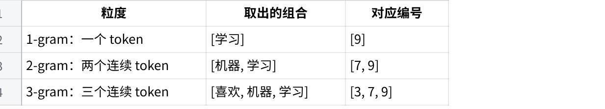
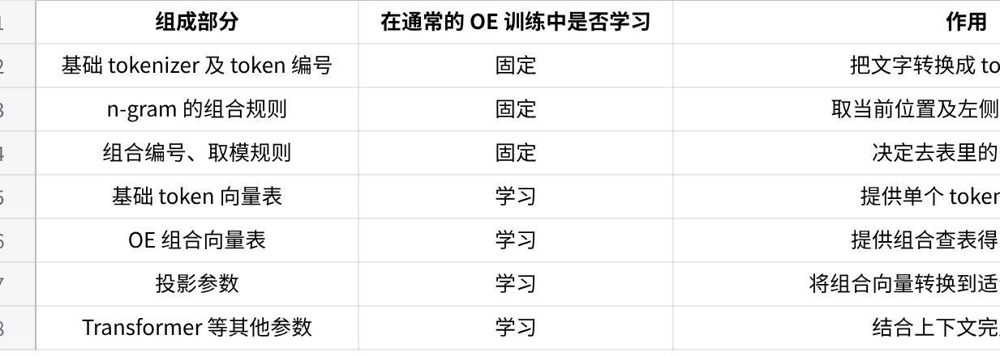
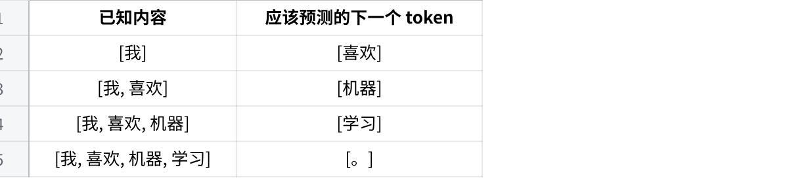
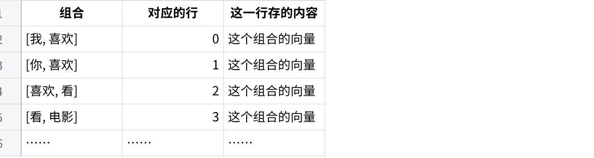
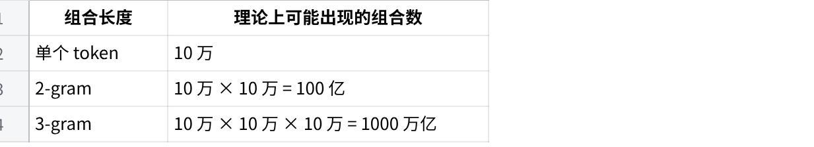
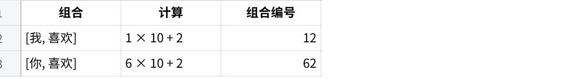
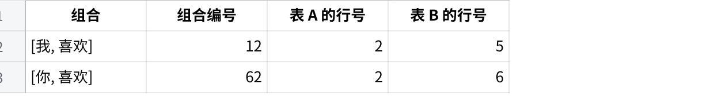
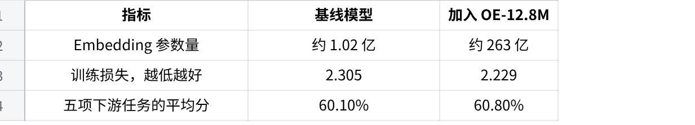

“Over\-Encoding”这一名称来自字节跳动 Seed 团队的论文 *Over\-Tokenized Transformer: Vocabulary is Generally Worth Scaling*，首次提交于 2025 年 1 月 28 日，后被 ICML 2025 接收 https://arxiv\.org/abs/2501\.16975


Over\-Encoding（简称 OE）是一种增强大模型输入表示的方法：除了给“单个 token”查一张向量表，还给“连续多个 token 的组合”查额外的向量表，再把这些信息融合起来，送入 Transformer。


我们可以类比理解为：学英语时，除了记住单词，还一起学习常见搭配


示例：

普通输入表示：

看到 City → 查出 City 对应的向量


Over\-Encoding：

看到 New York City 中的 City

→ 查出 City 的向量

→ 查出 York City 这个组合的向量

→ 查出 New York City 这个组合的向量

→ 把这些向量融合起来


## 没有OE时Embedding的局限性

模型使用tokenizer把输入文本转化为id

例如输入：

New York City

转换成

\[12, 34, 56\]

这里的 12、34、56 是 token ID。token id 还不能代表语义向量。需要依靠embedding层把编号转换成一串浮点数

PyTorch 中的 nn\.Embedding 就是一张可训练的查找表：输入整数编号，输出对应行的向量 https://docs\.pytorch\.org/docs/2\.14/generated/torch\.nn\.Embedding\.html

假设词表有 $V$ 个 token，每个 token 用 $d$ 个数字表示，那么这张表的形状类似于


第1维    第2维    第3维    ……    第d维

token 0      0\.12    \-0\.30     0\.08      ……

token 1      \-0\.21     0\.45     0\.19       ……

……

token V     0\.35     0\.11    \-0\.27       ……


但是使用Embedding 存在一个局限性，就是 这个token的向量不随上下文改变而改变。其争端的d维信息内容，只取决于token自己的内容。

例如两段话

New York City

a beautiful City

假设 `City` 在两处都是同一个 token，那么它们从普通 Embedding 表中取出的初始向量相同。

这不代表模型不能区分上下文。后续 Transformer 会结合前面的内容，逐层更新表示


OE 则把一部分局部组合信息提前加入输入：不只是提供“这是 City”，还提供“它前面是 York”“它前面是 New York”。


## Over\-Encoding 原理

其基本逻辑可以拆解为以下步骤

文字 → 切成 token → 查表得到向量 → Transformer 处理 → 预测下一个 token

OE主要改进的，就是“查表得到向量”这一步。


### 构造 n\-gram

使用N\-gram 进行token的组合生成。这里的 $n$ 表示组合中有几个 token。

例如示例

\[我\] \[喜欢\] \[机器\] \[学习\]

1       3         7         9

分词器已经完成切分。接下来，OE 在这些 token 上构造 n\-gram。

n\-gram 在这里，就是“截至当前位置，取连续 n 个 token 组成一组”。

我们只盯着最后的“学习”这个位置：



到这里，n\-gram 做的事就结束了：它只是取出这些组合。

它还没有生成向量，也没有理解这些组合的意思。

另外，这些组合会重叠。例如，使用 2\-gram：

“喜欢”位置 → \[我, 喜欢\]

“机器”位置 → \[喜欢, 机器\]

“学习”位置 → \[机器, 学习\]

### 如何把组合变成向量

上述这些n\-gram扫描出来的组合用来决定“去额外的向量表里查哪一行”。

仍然只看“学习”位置，先使用 2\-gram：

```Plain Text
[机器, 学习]
      ↓ 取出 token 编号
    [7, 9]
      ↓ 按固定规则计算行号
     行号 2
      ↓ 读取组合向量表
    G₂[2]
      ↓
得到一串数字，也就是额外的组合向量
```

这里：

- `G₂` 表示专门处理两个 token 组合的一张表。

- `G₂[2]` 表示读取它的第 2 行。

- 表里每行的数字是通过训练学出来的。


为什么这个例子得到行号 `2`？如果假设基础词表大小为 `10`、组合表有 `7` 行，那么：

组合编号：7 × 10 \+ 9 = 79

表内行号：79 除以 7 的余数 = 2


如果也使用 3\-gram，就用 `[3,7,9]` 按类似规则，去相应的组合表里再查一份向量。


### 向量融合

查完这些向量后，把它们融合，形成当前位置最终的输入向量。

对于“学习”这个位置，普通模型原来只有：“学习”这个基础的向量

加入 OE 后，会得到：

“学习”的基础向量

\+

\[机器, 学习\] 查出来的组合向量

\+

\[喜欢, 机器, 学习\] 查出来的组合向量

↓ 融合

“学习”这个位置最终的输入向量

实际实现会先把各份向量转换成相同的长度，再相加等处理。这个转换也叫“投影”，可以暂时理解成让它们能够一起融合。

融合后的向量，才被送进 Transformer。


### 组合向量表如何训练

现在我们回答两个问题：

- 组合向量查询的表里的数字从哪里来，为什么它们能帮助模型预测？

- 增加这些表，究竟获得了什么，又付出了什么？


OE 的向量表通过模型训练学出来。组合到行号的映射规则通常保持固定，训练改变的是表里的数字，以及处理这些数字的投影参数。



例如，假设 `[机器, 学习]` 按规则映射到组合表的第 2 行。

训练前后，它都去读取第 2 行。但是，第 2 行里面的数字会随着训练不断变化：

固定不变的部分：

\[机器, 学习\] → 计算行号 → 第 2 行


不断学习的部分：

第 2 行：\[数字1, 数字2, 数字3, ……\]

因此，训练的重点是让这些数字逐渐变得有用。


第一步，创建表，并为参数设置初始值。

向量表初始化：

研究人员先决定使用哪些 n\-gram、每张表有多少行、每行向量有多少个数字，然后分配存储空间

第 0 行：\[ 0\.03, \-0\.07,  0\.11\]

第 1 行：\[\-0\.02,  0\.05,  0\.09\]

第 2 行：\[ 0\.20, \-0\.10,  0\.30\]

……

此时，即使 `[机器, 学习]` 能查到第 2 行，也只是按照规则取出了一串初始数字。要让它有用，还需要后续训练。


第二步，用训练文本提供预测任务和正确答案。

语言模型通常通过“根据前文预测下一个 token”来学习。

假设训练文本被切成：

\[我\] \[喜欢\] \[机器\] \[学习\] \[。\]

这段文本可以提供多个训练任务：




第三步，使用当前参数完成一次预测。

模型按照前面介绍的流程处理输入。

在“学习”位置，它可以查出：


“学习”的基础向量


\[机器, 学习\] 对应的组合向量


\[喜欢, 机器, 学习\] 对应的组合向量


这些向量经过投影、融合，再送入 Transformer，最终得到对下一个 token 的预测概率。

假设模型给正确答案“。”的概率只有 10%。

这说明当前整套参数对这个训练样本的预测还不够好。接下来，调整损失函数即可。

直到这些融合向量预测下一个token为“。”的概率满足目标阈值。


### 使用n\-gram组合查找向量时的问题

#### 问题1\-token组合如何对应到查询表的一行

现在我们来介绍一下OE在实际查找向量时会遇到的一类问题。


n\-gram组合查找向量时的问题

假设模型输入是：

我 / 喜欢 / 看 / 电影

在“喜欢”这个位置，除了查询“喜欢”本身的向量，OE 还想查询这个组合的向量：

\[我, 喜欢\] → 一个表示这个搭配的向量

这里的“组合向量”是训练得到的参数。n\-gram 只负责构造组合，接下来还必须有一套办法，把组合对应到表中的某一行。

最直观的设计，是给每一种组合单独分配一行：



这样查询很容易理解：


每个组合都有自己的位置，也就不会因为共用一行而互相干扰。

第一个问题是：可能出现的组合太多了，这张表会大到无法接受。

假设基础词表有 10 万个 token：



如果给每个 2\-gram 存一个 256 维的 BF16 向量，仅这张表就需要约 5\.12 TB。

而且，很多组合非常罕见，甚至从未在训练数据里出现。为所有可能组合都准备独立的向量，代价很大。

于是，OE的做法是把表的行数限制住：组合可以有很多，但只准备固定数量的向量，让这些组合使用它们。


#### 问题2\-组合的数量远远超过表的行数，怎样确定每个组合该查哪一行？

OE 论文中的做法可以分成两步。

先给组合计算一个编号。为了方便理解，假设词表只有 10 个 token，其中：

“我”的 token ID = 1

“你”的 token ID = 6

“喜欢”的 token ID = 2

对一个 2\-gram，按下面的规则计算：

组合编号 = 前一个 token ID × 10 \+ 当前 token ID

那么我们会有



到这里，两种组合仍然区分得很清楚：一个编号是 12，另一个是 62。

但是，如果实际只准备了一张 5 行的表，就不能直接读取第 12 行或第 62 行，因为根本没有这些行。

因此，再做一次取余：表中的行号 = 组合编号 % 表的行数

对于这张 5 行的表：

\[我, 喜欢\] → 编号 12 → 12 % 5 = 2

\[你, 喜欢\] → 编号 62 → 62 % 5 = 2


现在两种组合都可以查表了，但它们都被分配到了第 2 行。

#### 问题2\-为了把大量组合放进有限的表，我们让不同组合共用了同一个向量。发生哈希冲突


假设第 2 行存着：E\[2\] = \[0\.3, \-0\.1, 0\.8, 0\.2\]

\[我, 喜欢\] → \[0\.3, \-0\.1, 0\.8, 0\.2\]

\[你, 喜欢\] → \[0\.3, \-0\.1, 0\.8, 0\.2\]

原本，我们希望 OE 提供的信息是：当前都是“喜欢”，但前面接的是“我”还是“你”？可是在这张表里，两个搭配得到完全相同的向量。这条 OE 特征无法表达它们的区别。

这里OE的解决办法是查表，因为一张有限大小的表会让不同组合共用一个向量。那么，让一个组合查询多张表，用多个向量共同表示它

例如：表 A 有 5 行：查询 编号 % 5   而 表 B 有 7 行：查询 编号 % 7

原本的例子就变为



### 收益与代价

收益

- 增加了输入阶段的表示能力。\-\-显而易见

- 增加参数容量时，每个 token 的额外计算可以相对较小\-\-可以通过算哈希值直接得到token组合在表中的向量位置

- 在合适的训练配置下改善模型效果和收敛表现。\-\-更好的表达，更容易达成任务效果

代价

- 存储更多参数\-\-n\-gram 表达带来更多存储需求

- 内存访问和分布式通信\-\-表很大时，需要把它分散到多张 GPU 上

- 需要足够的训练数据和训练时间\-\-参数多训练长


以论文中，OLMoE\-7B 的一组对比结果如下


