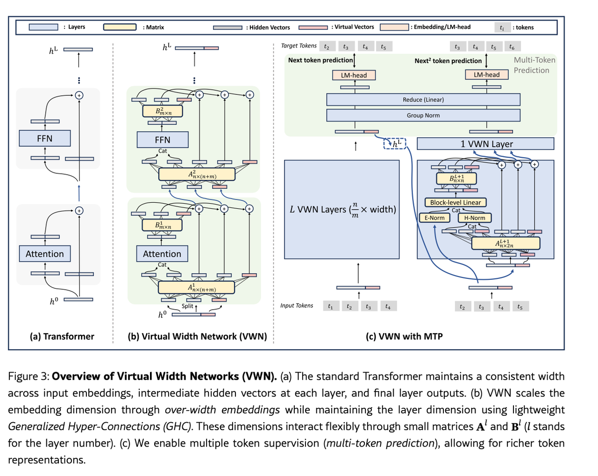
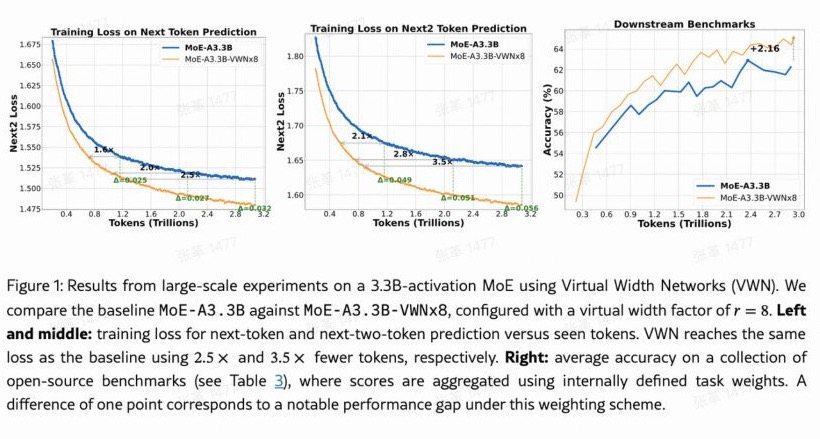

Virtual Width Networks  https://arxiv.org/abs/2511.11238

由 ByteDance Seed 团队于 2025 年 11 月发布。

它的核心想法是让模型每层能保留更多信息，同时让昂贵的计算继续在较窄的维度里进行

这是一种兼顾模型表达能力与计算量的 Transformer 架构设计

## 背景

大模型处理一个 token 时，会用一串数字表示它，长度称为隐藏维度 D。例如，D=4096，意味着每个 token 的当前状态由 4096 个数字表示。

把这串数字加长，可以增加表达信息的空间。但许多线性变换的计算量与 $D^2$ 有关：维度翻倍，相关计算可能接近四倍。直接把整个模型加宽，代价很高。

## 实现原理

VWN 把两个原本绑定的东西拆开：

- 表征宽度：沿着网络各层传递、保留的信息有多宽。
- 计算宽度：Attention、FFN 实际处理的向量有多宽。

它扩大前者，维持后者。架构可见下图。其说明的是VWN 如何把标准 Transformer 的一条残差通道，改造成更宽的状态通道＋原宽度的计算模块，以及如何接上[MTP](/model-inference/multi-token-prediction/)



### 架构图（a）部分-标准 Transformer

该部分在展示一个标准 Transformer 传递信息的过程

最下面h0是 token 进入第一层 Transformer 之前的初始embedding。它先经过 Attention，再经过 FFN，每个模块外面都有一条残差旁路：

$$
\begin{aligned}
u &= h^0 + \operatorname{Attention}(h^0), \\
h^1 &= u + \operatorname{FFN}(u).
\end{aligned}
$$

这里省略了归一化等常规操作。图中弯曲的旁路线负责传递原来的状态，圆圈中的 ＋ 将原状态与模块计算结果相加。重复 $L$ 层后，得到顶端的 $h_L$

架构图a这一部分想建立一个参照：输入 embedding、层间状态，以及 Attention、FFN 的输入输出，宽度都是 $D$。FFN 内部可以升维，但它的输入输出仍回到 $D$。

### 架构图（b）部分 - VWN

中图在标准 Transformer 的连接结构上引入了 GHC，广义超连接。为了方便大家理解，下面先介绍一下什么是GHC

### GHC，广义超连接

GHC 的全称是 Generalized Hyper-Connections，广义超连接。它是一种连接网络各层、控制信息如何流动的机制。VWN 用它连接“更宽的隐藏状态”和“原宽度的计算模块”。

这种方法就是由seed提出的

**3.3 Generalized Hyper-Connections**

We propose *Generalized Hyper-Connections (GHC)*, a novel method to effectively leverage wider token embeddings while maintaining the original hidden dimension during intermediate layer computations. Specifically, at each layer $l$, GHC introduces a light transformation matrix $\mathcal{GHC}^l$ that encodes weighted relationships between segments of the original hidden representations and the expanded token embeddings. Formally, this matrix is defined as follows:

$$
\begin{aligned}
\mathcal{GHC}^{l}
&= \begin{pmatrix}\mathbf{0}\ \mathbf{B}^{l} \\ \mathbf{A}^{l}\end{pmatrix}
= \begin{pmatrix}\mathbf{0}\ \mathbf{B}^{l} \\ \mathring{\mathbf{A}}^{l}\ \widehat{\mathbf{A}}^{l}\end{pmatrix} \\
&= \begin{pmatrix}
0 & \cdots & 0 & \beta^l_{1,1} & \cdots & \beta^l_{1,n} \\
& \ddots & & \vdots & \ddots & \vdots \\
0 & \cdots & 0 & \beta^l_{m,1} & \cdots & \beta^l_{m,n} \\
\alpha^l_{1,1} & \cdots & \alpha^l_{1,m} & \alpha^l_{1,m+1} & \cdots & \alpha^l_{1,m+n} \\
& \ddots & & \vdots & \ddots & \vdots \\
\alpha^l_{n,1} & \cdots & \alpha^l_{n,m} & \alpha^l_{n,m+1} & \cdots & \alpha^l_{n,m+n}
\end{pmatrix}
\in \mathbb{R}^{2m\times(m+n)}.
\end{aligned}
$$

Consider the $l$-th network layer $\mathcal{F}^l$, it integrates self-attention layers or feed-forward networks within transformers. The output of the GHC, denoted as $\mathbf{H}^{\prime l}=\operatorname{Reshape}(\mathbf{h}^{\prime l},(n,D^{\prime}/n))$, represents the Over-Width Hidden States, and can be formulated as:

$$
\begin{aligned}
\mathbf{H}^{\prime l}
&= \mathcal{GHC}^l(\mathcal{F}^l,\mathbf{H}^{\prime\,l-1}) \\
&= \mathbf{B}^{l\mathsf{T}}\mathcal{F}^l\!\left(\mathring{\mathbf{A}}^{l\mathsf{T}}\mathbf{H}^{\prime\,l-1}\right)+\widehat{\mathbf{A}}^{l\mathsf{T}}\mathbf{H}^{\prime\,l-1}.
\end{aligned}
$$

我们可以从 (a) 中熟悉的残差连接入手，会更容易理解：

其中 $T$ 可以是 Attention 或 FFN。普通残差连接的规则固定将 $h$ 送进计算模块 $T$，同时保留一份 $h$，最后两者直接相加。

GHC 将这个固定规则扩展为可学习的信息混合，控制三个环节：

| 环节 | 要决定的问题 |
| --- | --- |
| 读取 | 从当前状态中组合出哪些信息，送入计算模块？ |
| 保留 | 已有信息如何混合，并沿旁路继续传递？ |
| 写回 | 模块算出的结果，如何分配到新的状态中？ |

因此，可以把它理解为一种可学习的残差连接机制：

$$
H_{\text{new}}=\operatorname{Keep}(H)+\operatorname{Write}\!\left(T(\operatorname{Read}(H))\right)
$$

这里的 Read、Keep、Write 是为了便于理解而使用的功能名称，对应图中 A、B 承担的操作。A,B的具体位置我在下面重新标记出来。A 同时负责 Read 和 Keep，B 负责 Write。下面我们结合图片理解A和B是如何负责彼此的功能的。

在图片中我们可以看到A模块设计大小为 $A_{n\times(n+m)}$，A的不同列负责生成不同用途的输出。

我们可以把A沿列拆开

$$
\underbrace{A}_{n\times(m+n)}=
\left[
\underbrace{A_{\mathrm{read}}}_{n\times m}
\;\middle|\;
\underbrace{A_{\mathrm{keep}}}_{n\times n}
\right]
$$

以图中的 $m=2,n=3$ 为例,那么对于A来说它有3行、5列

$$
A=
\begin{bmatrix}
a_{11} & a_{12} & a_{13} & a_{14} & a_{15} \\
a_{21} & a_{22} & a_{23} & a_{24} & a_{25} \\
a_{31} & a_{32} & a_{33} & a_{34} & a_{35}
\end{bmatrix}
$$

沿列拆开指在第 2 列和第 3 列之间画一条线：

$$
A=
\left[
\begin{array}{cc|ccc}
a_{11} & a_{12} & a_{13} & a_{14} & a_{15} \\
a_{21} & a_{22} & a_{23} & a_{24} & a_{25} \\
a_{31} & a_{32} & a_{33} & a_{34} & a_{35}
\end{array}
\right]
$$

于是可以把它记成两个子矩阵：

$$
A=[A_{\mathrm{read}}\mid A_{\mathrm{keep}}]
$$

为什么可以按列进行切分呢

因为我们在进行矩阵运算时，对于

$$
A^{\mathsf T}H
$$

A 的每一列负责生成一个输出块。

假设输入宽状态包含三个块：

$$
H=
\begin{bmatrix}
H_1 \\ H_2 \\ H_3
\end{bmatrix}
$$

那么 A 的第一列：

$$
\begin{bmatrix}
a_{11} \\ a_{21} \\ a_{31}
\end{bmatrix}
$$

生成第一个输出块：

$$
X_1=a_{11}H_1+a_{21}H_2+a_{31}H_3
$$

以此类推第二列生成第二个输出块X2，3，4,5列生成3,4，5个分别标记为S1,S2,S3输出块。那么我们有

| A 的列 | 生成的输出 | 用途 |
| --- | --- | --- |
| 第 1 列 | X1 | 送入 Attention |
| 第 2 列 | X2 | 送入 Attention |
| 第 3 列 | S1 | 走旁路 |
| 第 4 列 | S2 | 走旁路 |
| 第 5 列 | S3 | 走旁路 |

所以我们把A的前两列称为Aread，后三列称为Akeep。A 的前 $m$ 列生成送入计算模块的 $m$ 个块，后 $n$ 列生成沿旁路传递的 $n$ 个块，m表示一个D维向量切成多少块，n表示把宽状态保存多少块。

这里再次结合图片来看更容易理解。

| 功能 | 对应矩阵 | 操作与结果 |
| --- | --- | --- |
| Read | A 的前 $m$ 列 | $X=A_{\mathrm{read}}^{\mathsf T}H$，生成 $m$ 块，拼成 $D$ 维送入计算模块 |
| Keep | A 的后 $n$ 列 | $S=A_{\mathrm{keep}}^{\mathsf T}H$，生成 $n$ 块，走旁路 |
| Write | B，形状 $m\times n$ | $W=B^{\mathsf T}Z$，将模块输出的 $m$ 块分配成 $n$ 块 |

GHC 的 Read、Keep、Write 都是通过训练学出来的。另外图片中A,B右上角的数字编号表示 其处于GHC的第几个链接位置。1 表示Attention 周围使用第一组参数 2表示FFN 周围使用第二组参数

所以图中的数据流是：

```text
宽状态
  ↓
A¹ → Attention → B¹
  ⇅
A² →   FFN     → B²
  ↓
新的宽状态

A1学习应该怎样为 Attention 读取和保留信息。
B1 学习怎样把 Attention 结果写回。
A2 学习怎样为 FFN 读取和保留信息。
B2 学习怎样把 FFN 结果写回。
```

所以总结来说

第一层接收宽 embedding，后续各层接收上一层输出的宽隐藏状态。A 从当前宽状态中生成计算输入和旁路状态。把宽状态的多个块加权混合成较窄的输入，送给 Attention/FFN

B 则把计算结果分配回宽状态，和旁路信息合并

通过 A 将宽状态混合成窄输入进行计算，再通过 B 写回宽状态，以较小的额外计算成本扩大表征空间。

### Split

我们可以注意到 架构图b的输入还有一个split 标识

这部分是为了把一整条宽向量整理成多个小块，让后面的 A 能以“块”为单位组合信息。

假设向量有六个数字， 拆成3块

```text
拆分前：[1, 2, 3, 4, 5, 6]
拆分后：H₁ = [1, 2]
        H₂ = [3, 4]
        H₃ = [5, 6]
```

Split 本身只是分组，数字没有改变，信息也没有丢失。

分块之后，A 就可以给每个块分配权重，组合出送入 Attention 的信息。例如，假设 Attention 需要 4 维输入，也就是两块，可以这样组合：

$$
\begin{aligned}
X_1 &= H_1+0.5H_3, \\
X_2 &= H_2+0.2H_3.
\end{aligned}
$$

然后再把X1和X2进行拼接喂入attention

所以，Split 的作用是：提供分块混合的基础，让 GHC 用少量权重，从宽状态中组合出计算模块需要的窄输入，同时保留宽状态通道。

所谓宽组合就是拆分前的向量， 分块后，A 将原来的三个块加权混合成两个新块，再拼接成 Attention 需要的输入。这里减少的是输出块的数量，每个原始块仍然可以参与混合。

### 架构图（c）部分 - VWM with MTP

我们按照左下主干 → 左上预测 → 右下融合 → 右上预测的顺序理解和介绍

#### 通过 VWN 主干理解输入

左下主干主要在描述 输入token变为embedding后，经过L个VWN层。 得到宽隐藏特征 $h_L$

其中=

可以分为两部分来理解， $L$ VWN Layers 表示连续堆叠 $L$ 个 VWN 层。

$\frac{n}{m}\times\mathrm{width}$ 其实应该这么看 $\frac{D}{m}\times n$

这么理解的话 就是D维除以m,这样能体现出把输入模型拆分出几块

例如m=2  D=406

```text
计算模块的输入： [2048维] [2048维]
```

n指层间传递的宽状态有多少块

例如 D=4096 m=2 n=3

```text
计算模块的输入： [2048维] [2048维]
层间的宽状态：   [2048维] [2048维] [2048维]
```

$$
D^{\prime}=n\times\frac{D}{m}=\frac{n}{m}D
$$

这里宽状态有三块，计算输入有两块，所以宽状态是计算输入的 $3/2=1.5$ 倍宽

通过这样的计算我们可以再次理解为什么vwn可以减少计算

#### 用主干状态预测下一个 token

左上角比较简单，就是输出状态预测

从 $h_i^L$ 到预测结果，中间经过：

```text
宽隐藏状态
    ↓
Group Norm：归一化，帮助稳定训练
    ↓
Reduce（Linear）：将宽状态从 D' 维汇总回 D 维
    ↓
LM-head：产生词表中各个 token 的预测分数
```

这里要注意的是如果只展示推理时“接着生成一个 token”，画 $t_5$ 就够了。图里画出 $t_2$ 到 $t_5$，是为了展示训练时每个位置都承担预测任务。

输入 $t_1,t_2,t_3,t_4$ 后，主干会在四个位置分别输出隐藏状态：

| 位置的隐藏状态 | 能看到的输入 | 预测目标 |
| --- | --- | --- |
| $h_1^L$ | $t_1$ | $t_2$ |
| $h_2^L$ | $t_1,t_2$ | $t_3$ |
| $h_3^L$ | $t_1,t_2,t_3$ | $t_4$ |
| $h_4^L$ | $t_1,t_2,t_3,t_4$ | $t_5$ |

训练时，这四个位置的预测都可以用来计算损失，因此图上保留了全部目标 $t_2,t_3,t_4,t_5$。因果遮罩保证每个位置只能看到自己及之前的输入。

推理时，如果 $t_1$ 到 $t_4$ 已经是给定前缀，我们主要使用最后一个位置 $h_4^L$ 的预测来生成 $t_5$。前面三个位置对 $t_2,t_3,t_4$ 的预测，不需要再作为新内容输出。

#### 结合主干状态和下一 token，准备预测更后面的 token。

右边新增一条 MTP 分支，接收两份信息 $h_i^L$ 和 e(t+1）

关于 $h_i^L$

$h_i^L$ 是第 $i$ 个 token 经过主干后的完整隐藏向量。 推图中它来自

这里是指灰蓝色＋红色组成的完整宽向量。图中蓝色箭头从右端引出，是表示整条向量流向右侧 MTP 分支，并不是只取红色部分。

这里两个下标、上标分别表示：

- $i$：序列中第 $i$ 个 token 的位置。
- $L$：经过 $L$ 个 VWN 层之后。

它是对已有前缀的向量表示

关于e(t+1)

在图中它其实就是这部分

注意这里的输入是t2,..t5

这个输入在模型训练时，来自训练文本中的下一个 token，直接用embeeding层查表的方式查到下一个token的向量表示。 这种提供真实前一步 token 来训练后续预测的方式，称为 teacher forcing。

在实际模型推理时，没有真实的下一个token，所以如果启用 MTP 分支，就使用模型刚生成的下一token.也就是架构图左上角生成的。下图用红框和线条圈了出来方便理解

那么这两种信息会在右下角蓝色方块中进行融合。顺着蓝色的线来理解

其中 Block-level Linear 是 VWN 在这里控制成本的关键。

假设隐藏状态和 embedding 都分成三块。可以把它理解为对应块分别融合：

```text
隐藏块 H₁ ＋ embedding 块 E₁ → 融合块 F₁
隐藏块 H₂ ＋ embedding 块 E₂ → 融合块 F₂
隐藏块 H₃ ＋ embedding 块 E₃ → 融合块 F₃
```

每一对块先拼接，再通过一个小线性映射；各块共享这个映射。这样可以避免对两个超宽向量直接使用一个庞大的全连接矩阵   论文相关处https://arxiv.org/html/2511.11238v2#S3.SS4

我们举例来理解这块的设计：

假设隐藏状态 $H$ 和下一 token 的 embedding $E$ 都有 6 个数字，分别拆成三块：

```text
H = [1, 2 | 3, 4 | 5, 6]
E = [7, 8 | 9,10 |11,12]
```

对应关系是：

```text
隐藏块 H₁ ＋ embedding 块 E₁ → 融合块 F₁
隐藏块 H₂ ＋ embedding 块 E₂ → 融合块 F₂
隐藏块 H₃ ＋ embedding 块 E₃ → 融合块 F₃
```

拼接就是把数字排在一起：

```text
第 1 对：[1, 2] 和 [7, 8]   → [1, 2, 7, 8]
第 2 对：[3, 4] 和 [9,10]   → [3, 4, 9,10]
第 3 对：[5, 6] 和 [11,12]  → [5, 6,11,12]
```

现在每对都有 4 个数字。

用一个小 Linear，把每对的 4 个数字变成 2 个数字。

这个 Linear 是一个训练出来的映射 $f$

那么经过这个函数

```text
[1, 2, 7, 8]  → f → 输出块 F₁：2 个数字
[3, 4, 9,10]  → f → 输出块 F₂：2 个数字
[5, 6,11,12]  → f → 输出块 F₃：2 个数字
```

各块共享这个映射就是：三行使用同一个 $f$，参数完全相同。 输入不同，因此输出也不同。

最后，把三个输出块拼起来，又得到一个 6 维向量。

对比两种做法：

| 做法 | 权重数量 |
| --- | --- |
| 整体融合 | $6\times12=72$ |
| 按块融合 | $2\times4=8$，重复使用三次 |

不计偏置，整体融合需要 $6\times12=72$ 个权重；按块融合只需要一份 $2\times4=8$ 个权重，重复使用三次。

图中融合位置的 A 是 $n\times2n$，因为它要产生 $n$ 块用于融合、$n$ 块用于保留；B 是 $n\times n$，负责把融合后的 $n$ 块结果分配回宽状态。这与（b）的 Read、Keep、Write 思路一致

#### 根据融合后的状态预测再下一个 token

右上角就是使用融合结果再经过一个 VWN 层，以及 Group Norm、Reduce、LM-head，预测 $t_{i+2}$。

### 窄计算如何利用宽状态

在 VWN 中，A 会从宽状态中组合出一个 $D$ 维输入，交给 Attention 或 FFN。但与此同时，另一条旁路仍然传递宽状态。因此，当前计算模块没有接收到的某些信息，仍有机会沿旁路保留，供后面的层使用。

这与先把宽 embedding 压缩成 $D$ 维，再送入普通 Transformer有一个重要区别：后者从压缩完成之后，就只能围绕这个 $D$ 维结果继续计算；VWN 则允许后面的层再次从更新后的宽状态中读取信息，

这部分论文中有过分析 https://arxiv.org/html/2511.11238v2#S4  对应A Connectivity Perspective 的讨论

```text
当前宽状态：[H₁，H₂，H₃]
                  │
                  ├→ 本层读取 H₁、H₂ → 计算 → 写回
                  │
                  └→ 旁路保留三块状态
                              ↓
                     更新后的宽状态
                              ↓
                 下一层采用不同的读取方式
```

多层vwn带来不同角度宽状态的使用，而每次使用的计算量却是压缩的维度

### 收益



最后贴一张文章开头的figue1 展示vwn 总体收益：训练时 更省token， 同时下游任务表现也更好

这张图对比了 MoE-A3.3B 基线与 8 倍虚拟宽度的 VWN，三个子图分别说明：

| 子图 | 展示的收益 |
| --- | --- |
| 左：下一 token 的训练 loss | 达到图中相同 loss，VWN 所需 token 数约为基线的 1/2.5 |
| 中：下两个 token 的训练 loss | 达到图中相同 loss，所需 token 数约为基线的 1/3.5 |
| 右：下游评测表现 | 在论文的加权评测集合上，报告 +2.16 分的提升 |
